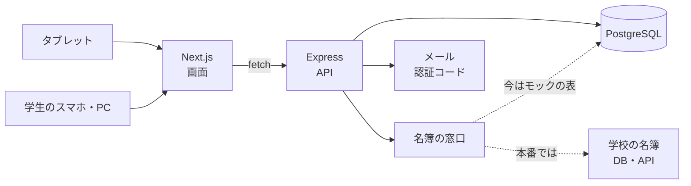

# 生徒カードで使う、機材・本の貸し出し管理システム

学校の生徒カードをタブレットで読み取って本人確認し、機材や本のバーコードを読むだけで貸し出し・返却を記録するWebシステムです。学生は自分のスマホから、借りている物と返却期限を確かめられます。

<div align="center">
  
</div>

## このリポジトリの今の状態

- **2025年度の学校の課題**(学校の困りごとをWebアプリで解決する)として、2026年2月に2人で作った試作です
- **今は ogawa が1人で作り直しています。** 作ってから1年で学んだことを使って、設計と品質を上げるためです。学校に実際に使ってもらうことも目指しています
- 作り直しでは、**AIと一緒に仕様を詰めて文書に残し、テストで確かめながら進める**やり方を試しています([AIと一緒に開発するための取り組み](#aiと一緒に開発するための取り組み))
- 進み具合と残りの作業は [docs/backlog.md](docs/backlog.md) にあります。これまでに、DBの二重管理の解消、学校の名簿を読む窓口の切り出し、エラーの形の統一、テストの整備(49件)が済んでいます。次は、APIの作り直しと、公共の場に置くタブレット向けの認証の作り直しです

## 何を解決するか

| 困りごと | このシステムで |
|---|---|
| 全校生徒が生徒カードを持っているのに、身分証明にしか使われていない | 生徒カードを、貸し出しの本人確認に使う |
| 本や機材の貸し出しを、紙の台帳で管理している。誰が何を借りているかがすぐに分からない | 貸し出し・返却をその場で記録し、貸出中・返却期限を画面で確かめられる |

**生徒カードのICチップについて**: 今の生徒カードには、実際にはICチップは付いていません。このシステムは将来ICチップが付く想定で作っていて、それまではカードの番号をバーコードで読むか手で入力して、ICの読み取りの代わりにしています。

## 主な機能

**タブレット(貸し出しの受付)**
- 生徒カードの番号を読んで本人確認する
- 物品のバーコードをカメラかバーコードリーダーで読んで、貸し出す・返す
- 貸出中・修理中の物は貸し出さない。2台で同時に同じ物を借りようとしても、記録は1件だけになる

**Webサイト(学生向け)**
- 学籍番号で登録する(学校の名簿のメールアドレスに届く認証コードで本人確認)
- 借りている物と返却期限を見る
- 機材カタログで、貸し出せる物があるかを見る

## 画面

| タブレット | Webサイト |
|---|---|
|  |  |
|  |  |
|  |  |

ほかの画面は [photo/](photo/) にあります。

## 技術構成

| 分類 | 使っているもの |
|---|---|
| 画面 | Next.js 16(App Router)、React 19、TypeScript、HeroUI、Tailwind CSS 4 |
| API | Node.js 24、Express 5、TypeScript、Zod |
| DB | PostgreSQL 16、Prisma 7 |
| テスト | Vitest |
| 開発環境 | Docker Compose |



## 設計で考えたこと

- **学校の名簿は「名簿の窓口」からだけ読む**: 本番の名簿は学校のDBかAPIになる前提です。名簿の読み方をインターフェース(`Roster`)1つにまとめ、今はモックの表を読む実装を使っています。名前やメールをこのシステムのDBに写さず、外部キーも張りません。本物の名簿に替えるときは、実装を1つ足すだけで済みます([back/src/features/roster](back/src/features/roster))
- **同じ事実を2か所に持たない**: 最初の作りでは、名簿の内容を利用者の表に写していたり、「貸出中」を物品と貸し出しの両方に持っていたりして、片方だけ古くなる不具合が出ていました。貸出中・延滞は返却日時と返却期限から決め、同時の貸し出しはDBの制約(部分インデックス)で防いでいます
- **エラーの形をそろえる**: どのエラーも RFC 9457(Problem Details)の形で、画面が分岐に使う`code`を付けて返します。`code`とステータス・文言の対応は1か所の表にあり、サービスの層はHTTPのことを知りません。次は、判断表(貸し出せるかなど)をそのまま関数にし、断る理由を戻り値で返す形にします
- **APIの設計を決めてから直す**: URLが動作の名前になっている、応答の形がばらばら、といった問題を洗い出し、直した後の形を [docs/api.md](docs/api.md) に決めてから、1本ずつ移しています
- **すぐに取り消せるログイン**: WebのログインはJWTのアクセストークンをやめ、サーバーのセッションにしました。番号はJavaScriptから読めないCookieにだけ入れ、DBにはハッシュだけを置きます。毎回DBで確かめるので、ログアウトや無効にした人は次のリクエストから止まります。JWTとセッションのどちらでもよいとされる中で、「1台のAPIで、毎回DBを見るならJWTの良さが無い」と判断した理由を [docs/auth.md](docs/auth.md) に残しています
- **公共の場に置くタブレットを前提にした認証**: 登録した端末からだけ使え、カードの番号とPIN(5回でロック)で本人を確かめ、その端末でだけ使える短いセッション(無操作30秒・最長3分・「終わる」ですぐ無効)にしました。カードの写しだけでは借りられず、立ち去った人の名前で次の人が借りることもできません。総当たりの対策を [docs/auth.md](docs/auth.md) に決めて、続けて作っています
- **総当たりの対策**: ログインは学籍番号ごとに続けて5回間違えたら15分止め、接続元ごとの回数も数えます。学校のWi-Fiでは全員が1つの接続元に見えるので、接続元ごとの分だけに頼ると、1人の打ち間違いで全員が止まるためです。認証コードはハッシュで持ち、5回間違えたら無効にし、申請は学籍番号ごとに回数を数えます(名簿にいない番号も同じに数え、名簿にいるかを知られないようにしています)。タブレットは端末ごとに失敗の回数を数えます

## AIと一緒に開発するための取り組み

作り直しは、AIのコーディング(Claude Code)と一緒に進めています。最も大事にしているのは、**自分とAIの認識の食い違いを小さくすること**と、**どこまで確かめられていて、どこが抜けているかを見えるようにすること**です。

- **仕様をAIと一緒に詰めて、`docs/`に置く**: 要件定義([docs/spec.md](docs/spec.md))、API設計([docs/api.md](docs/api.md))、認証の方針([docs/auth.md](docs/auth.md))。AIが問題と修正案を論点ごとの表で出し、自分が選び、決めたことを番号と日付付きで文書に残してから作業します
- **テストを、仕様のドキュメントの代わりにする**: テストの名前に仕様の番号(`R-16`・`C2`など)を入れ、正常系・異常系・境界値に分けています。仕様とテストの対応表([docs/spec.md の 8.1](docs/spec.md))で、確かめていない仕様が一目で分かるようにしています
- **AIの動き方を決めておく**: [CLAUDE.md](CLAUDE.md)(全体の決まりと進め方)、[.claude/rules/](.claude/rules/)(触る場所ごとの決まり)、[.claude/skills/](.claude/skills/)(観点ごとの知識。外から取り込んだものは、出典・ライセンス・中身の安全を確かめてから入れています。[ATTRIBUTIONS.md](.claude/skills/ATTRIBUTIONS.md))

## 分かっている課題とこれから

| 課題 | どうするか |
|---|---|
| 画面の一部に、手で書いた型と古いAPIの呼び出しが残っている(APIはすべて[docs/api.md](docs/api.md)の新しい形に移し、形は`shared/`にまとめた) | 画面も`shared/`の型だけにし、古い呼び出しを消す(残タスク0.7) |
| 物品の追加・編集(在庫管理)の画面が無い | 要件を決めてから作る(残タスク5) |
| 返却期限が近い・過ぎたことの通知が無い | Slackで知らせる(残タスク6) |
| 画面のテストと、HTTPを通すテストが無い | APIを作り直すときに足す |

## 動かし方

Docker が必要です。

```bash
git clone https://github.com/bro5ly/26-sinsakai-huyu.git
cd 26-sinsakai-huyu

# 環境変数(見本を写して、秘密の値を自分で入れる)
cp .env.example .env
cp back/.env.example back/.env
cp front/.env.example front/.env

docker compose up -d
docker compose exec api npx prisma migrate deploy   # DBの表を作る
docker compose exec api npm run db:seed             # テスト用のデータを入れる
```

| 開くもの | URL |
|---|---|
| Webサイト | http://localhost:4545 |
| タブレットの画面 | http://localhost:4545/tablet |
| テスト用のバーコードの印刷(開発のときだけ) | http://localhost:4545/barcodes |
| API | http://localhost:5454 |
| DBを見る(Prisma Studio) | http://localhost:5555 |
| 届いたメールを見る(Mailpit。開発のときだけ。外には送らない) | http://localhost:8025 |

**テスト用のデータ**(`back/prisma/seed.ts`)
- ログイン: 学籍番号`20240001`、パスワード`password123`(管理者は`90240001`)
- タブレットのカード: `IC-CARD-001`〜`IC-CARD-003`
- 物品のバーコード: `MAC-002`など(`MAC-001`は貸出中、`IPAD-005`は修理中)
- 新規登録を試すときの学籍番号: `20260001`。認証コードのメールはMailpit(http://localhost:8025)に届きます(`back/.env`の`MAIL_HOST=mailpit`・`MAIL_PORT=1025`。見本のとおり)。コードはハッシュで持つので、DBを見ても分かりません

**テスト**

```bash
docker compose exec api npm test           # APIのテスト
docker compose exec api npx tsc --noEmit   # 型チェック
docker compose exec web npm run build      # 画面のビルド
```

## ドキュメント

| ファイル | 内容 |
|---|---|
| [docs/spec.md](docs/spec.md) | 要件定義(ユースケース、要件、判断表、受け入れ基準、仕様とテストの対応、現状とのずれ、要確認) |
| [docs/api.md](docs/api.md) | API設計(全体の決まり、APIの一覧、資源の形、エラーの`code`) |
| [docs/auth.md](docs/auth.md) | 認証の作り直しの方針 |
| [docs/architecture.md](docs/architecture.md) | 今の仕組み(レイヤ、トークン、データモデル) |
| [docs/backlog.md](docs/backlog.md) | 残りの作業と順番、進め方 |
| [CLAUDE.md](CLAUDE.md) | AIと開発するときの決まりと進め方 |

## チーム

| | 担当 |
|---|---|
| ogawa | 発案、設計、実装の大部分、今の作り直し |
| もう1人のメンバー | 作成時に一部の機能を担当 |

## ライセンス

[MIT](LICENSE)
