# 生徒カードを活用した貸し出し管理システム

## 1. 作ったもの

**使われていない生徒カードに焦点を当てた、機材貸し出し管理システム**

学校で配布されているものの、ほとんど活用されていない生徒カード（学生証）。
このカードにICチップが組み込まれていることを想定し、機材の貸し出し・返却をスムーズに行えるシステムを開発しました。

> **ICチップについて**: 現在の生徒カードには、実際にはICチップは付いていません。本システムは将来カードにICチップが付くことを想定しています。それまではカードの番号をバーコードで読み取るか手入力することで、ICの読み取りの代わりにしています。

生徒カードをタブレットにかざすだけで認証し、バーコードスキャンで機材の貸し出し・返却を完結できる、直感的な操作を実現しています。

<div align="center">
  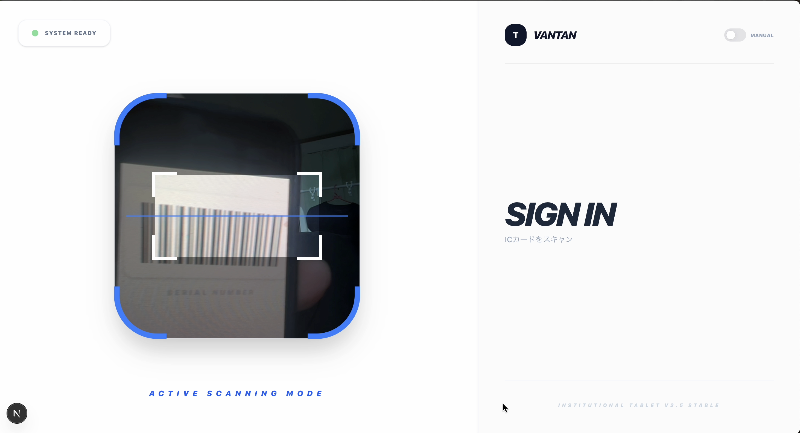
</div>

---

## 2. 主な機能

### 📱 タブレット機能（貸し出し受付端末）
- **ICカード認証**: 生徒カードをかざすだけでユーザー認証
- **バーコードスキャン**: カメラまたはバーコードリーダーで機材を識別
- **貸し出し/返却処理**: ワンタッチで貸し出し・返却を記録
- **リアルタイム在庫確認**: 機材の状態を即座に確認

<div align="center">
  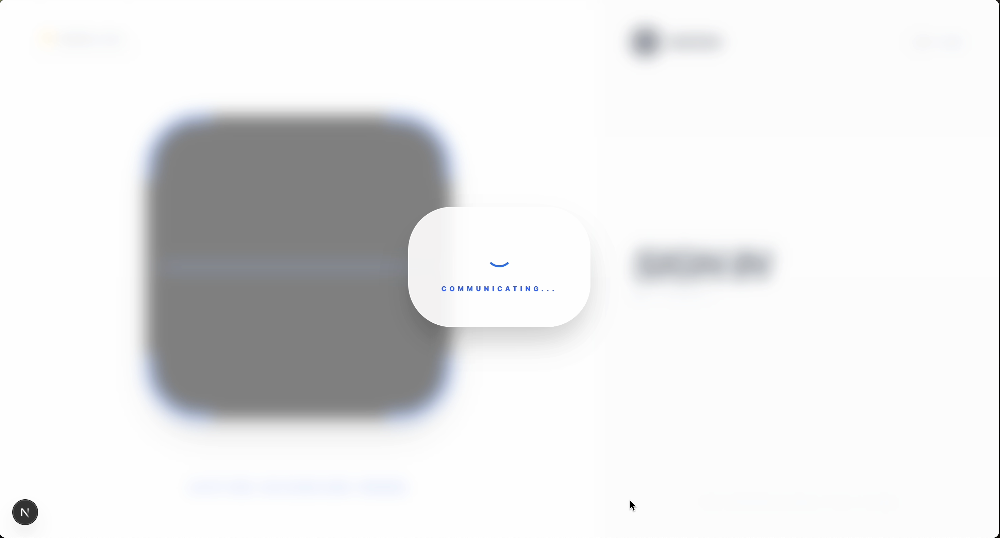
  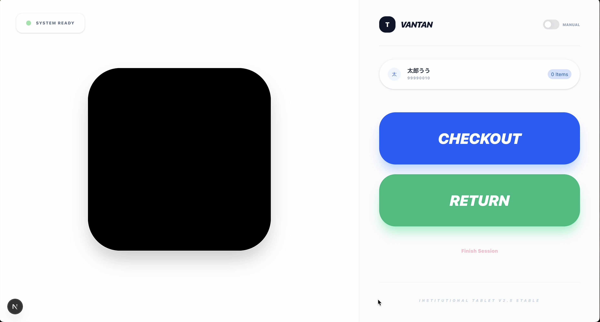
</div>

### 🌐 Webサイト機能（学生向けポータル）
- **学籍番号で新規登録**: メールによる本人確認で安全に登録
- **ダッシュボード**: 現在借りている機材の一覧表示
- **バーコード表示**: 自分のシリアルナンバーをバーコードで表示
- **機材カタログ**: 全ての機材の情報・貸出状況を確認
- **アイテム詳細**: 機材のスペックや貸出期間などの詳細情報

<div align="center">
  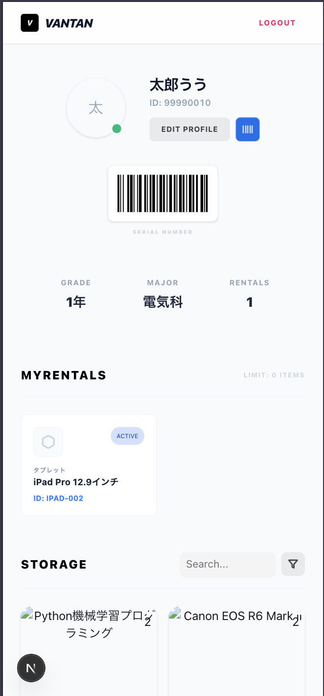
  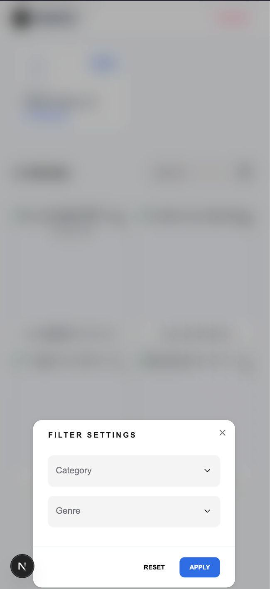
</div>

### 🔐 認証・セキュリティ
- **JWT認証**: アクセストークン + リフレッシュトークン
- **HTTPOnly Cookie**: セキュアなトークン管理
- **メール認証**: 登録時の本人確認

---

## 3. ユーザーフロー

### 📱 タブレットでの貸し出し・返却フロー

```
1. 生徒カードをタブレットにかざす
   ↓
2. カメラでQRコード/バーコードをスキャン（または手入力）
   ↓
3. 「貸し出し」または「返却」を選択
   ↓
4. 完了！
```

<div align="center">
  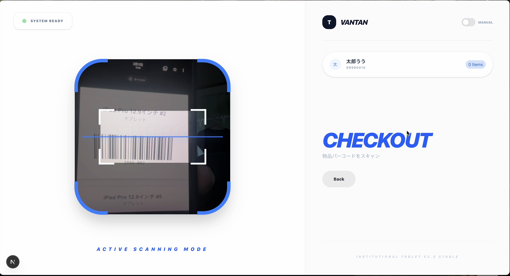
  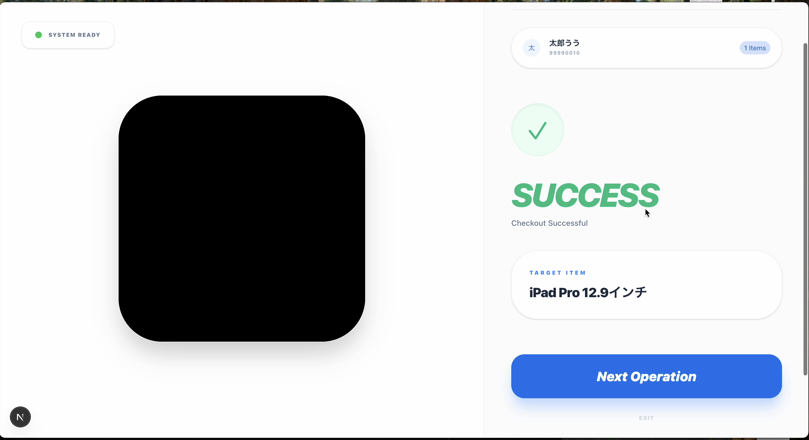
  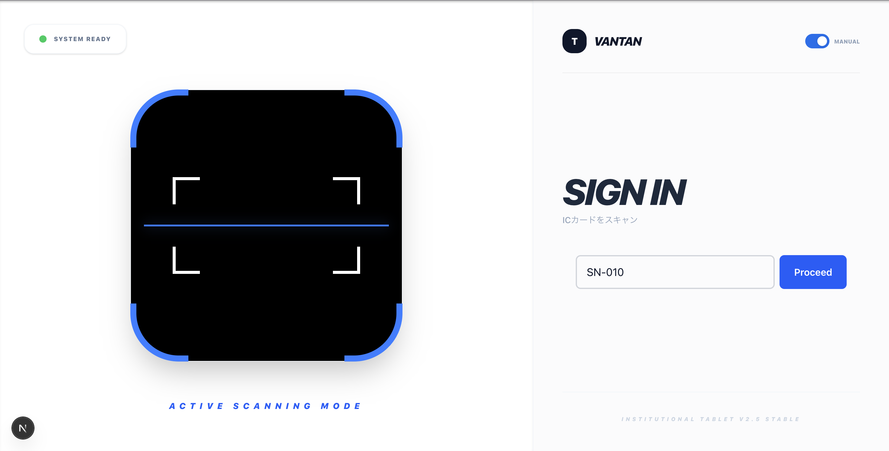
</div>

<div align="center">
  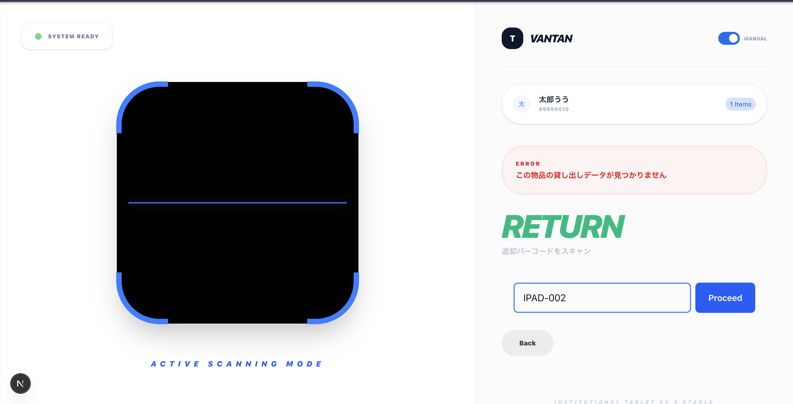
  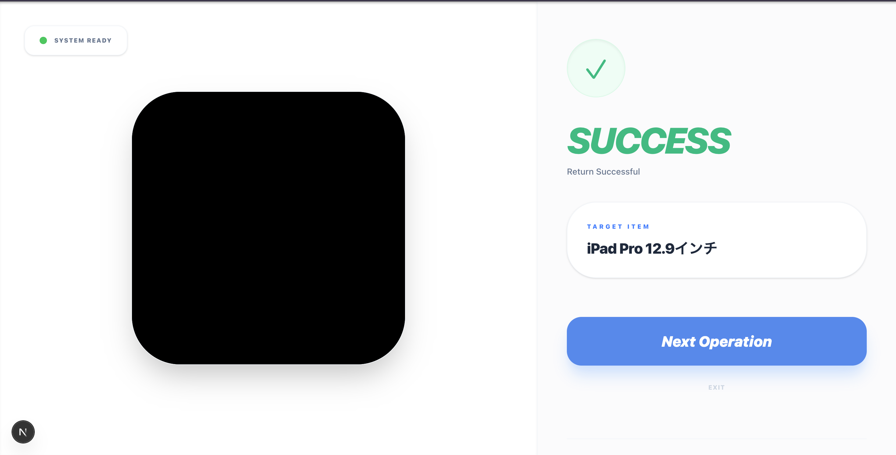
</div>

**特徴:**
- カードをかざすだけで学生情報を自動取得
- 現在の貸出状況をリアルタイム表示
- 迷わず操作できるシンプルなUI

---

### 🌐 学生向けWebサイトのフロー

#### 新規登録
```
1. 学籍番号を入力
   ↓
2. メールアドレスに認証コードが送信される
   ↓
3. 認証コードを入力
   ↓
4. パスワードを設定
   ↓
5. 登録完了！
```

<div align="center">
  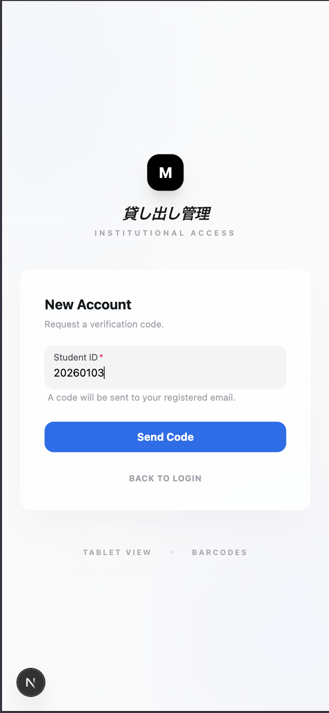
  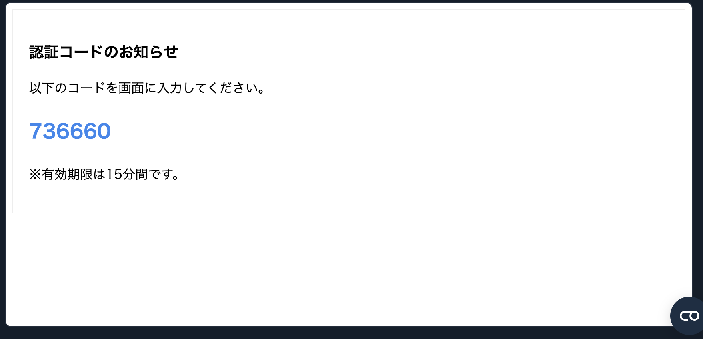
  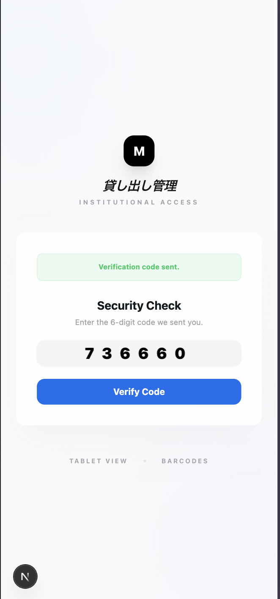
</div>

<div align="center">
  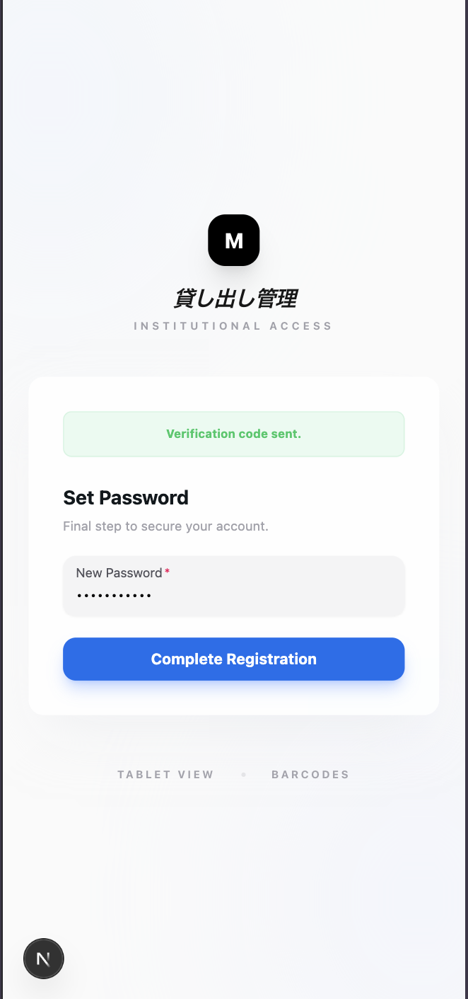
  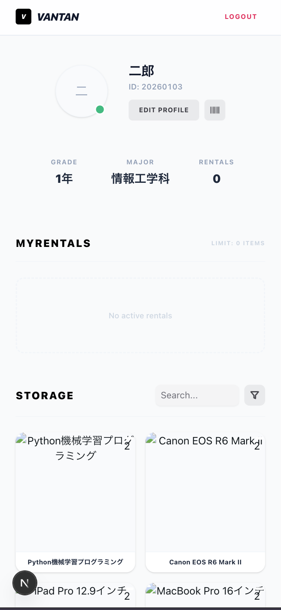
</div>

#### ログイン後の機能
```
ダッシュボード
├── 自分の情報（名前、学籍番号、学年、専攻）
├── バーコード表示（シリアルナンバー）
├── 現在借りている機材の一覧
└── 返却期限の確認

機材カタログ
├── 全機材の一覧表示
├── カテゴリ・ジャンル別フィルター
├── 貸出可能/貸出中のステータス
└── 機材詳細ページ
    ├── スペック情報
    ├── 貸出期間
    ├── 在庫数
    └── 現在の貸出状況
```

<div align="center">
  
  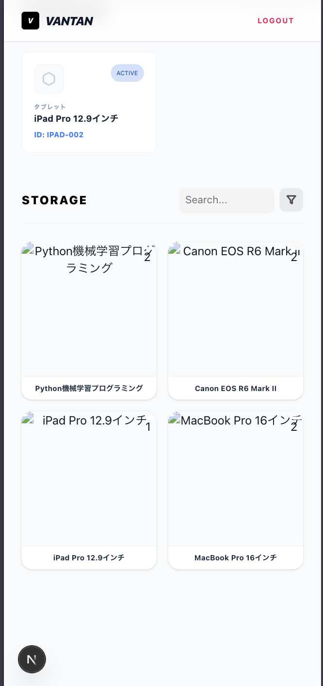
</div>

<div align="center">
  
  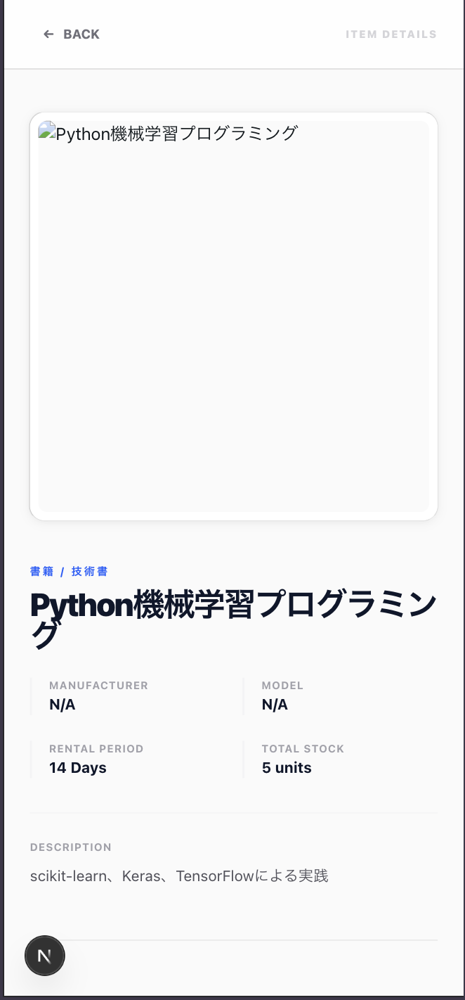
</div>

<div align="center">
  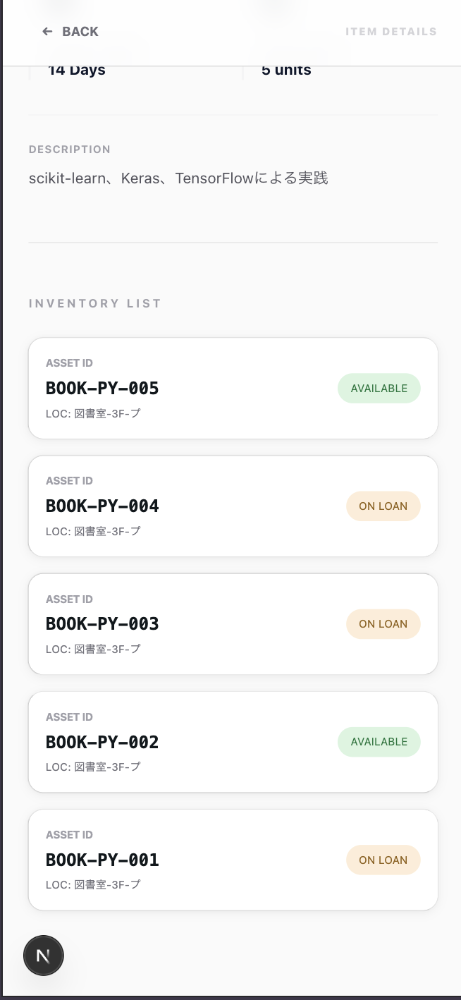
</div>

---

## 4. まとめと展望

### 📊 作ったもののまとめ

このシステムでは、**使われていない生徒カード（ICカード）を活用**し、機材の貸し出し・返却を大幅に効率化しました。

**主な成果:**
- ✅ タブレット端末でのスムーズな貸し出し・返却オペレーション
- ✅ 学生が自分で機材情報や貸出状況を確認できるWebサイト
- ✅ セキュアな認証システム（JWT + メール認証）
- ✅ リアルタイムな在庫管理
- ✅ 直感的で使いやすいUI/UX

**技術スタック:**
- **フロントエンド**: Next.js 16, React 19, TypeScript, Tailwind CSS
- **バックエンド**: Node.js, Express, Prisma ORM
- **データベース**: PostgreSQL
- **インフラ**: Docker, Docker Compose


---

### 🚀 今後の展望

#### 短期的な改善案
1. **Slack通知機能**
   - 返却期限が近づいたら自動リマインド
   - 延滞時の警告通知
   - 新着機材の通知

2. **予約機能**
   - 利用者が増えた際の予約システム
   - 人気機材の予約待ちリスト
   - 予約確認メール

#### 中長期的な拡張案
3. **管理者ダッシュボード**
   - 貸出統計・分析
   - 人気機材ランキング
   - 延滞者の管理

4. **モバイルアプリ化**
   - スマホから自分のバーコードを表示
   - プッシュ通知でリマインド

5. **AI活用**
   - 利用パターン分析
   - 最適な機材購入提案
   - 自動在庫最適化

---

## 技術詳細

### セットアップ

#### 必要な環境
- Docker
- Docker Compose

#### 起動手順

1. リポジトリをクローン
```bash
git clone <repository-url>
cd 2-13-sinsakai
```

2. Dockerコンテナを起動
```bash
docker-compose up -d
```

このコマンドで以下のサービスが起動します：
- **web**: フロントエンド (http://localhost:4545)
- **api**: バックエンドAPI (http://localhost:5454)
- **db**: PostgreSQLデータベース (localhost:1919)
- **studio**: Prisma Studio (http://localhost:5555)

3. データベースのマイグレーション（初回のみ）
```bash
docker-compose exec api npm run db:migrate
```

4. ブラウザでアクセス
- フロントエンド: http://localhost:4545
- Prisma Studio: http://localhost:5555

---

### プロジェクト構成

```
.
├── docker-compose.yml    # Docker構成ファイル
├── .env                  # 環境変数
├── front/                # Next.jsフロントエンド
│   ├── src/
│   │   ├── app/          # Next.js App Router
│   │   ├── components/   # UIコンポーネント
│   │   ├── contexts/     # React Context
│   │   ├── hooks/        # カスタムフック
│   │   ├── services/     # APIサービス
│   │   └── types/        # TypeScript型定義
│   ├── public/
│   ├── Dockerfile
│   └── package.json
└── back/                 # Express + Prismaバックエンド
    ├── src/
    │   ├── features/     # 機能別モジュール
    │   ├── middleware/   # 認証ミドルウェア
    │   └── lib/          # ユーティリティ
    ├── prisma/
    │   └── schema.prisma # データベーススキーマ
    ├── Dockerfile
    └── package.json
```

---

### ポート番号

| サービス | ポート | 説明 |
|---------|--------|------|
| web (フロントエンド) | 4545 | Next.jsアプリケーション |
| api (バックエンド) | 5454 | Express APIサーバー |
| db (データベース) | 1919 | PostgreSQLデータベース |
| studio | 5555 | Prisma Studio |

---

## ライセンス

MIT

---

## 開発チーム

Sinsakai Huyu Project Team

---

**生徒カードを、ただの身分証明書から、便利なツールへ。**
